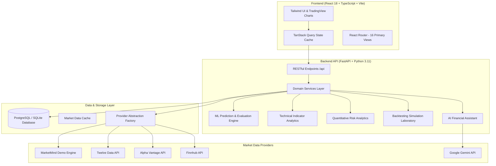

# MarketMind AI — Intelligent Stock Analysis & Prediction Platform

[](https://github.com/mohan2-hash/marketmind-Ai/actions)
[](https://www.python.org/)
[](https://fastapi.tiangolo.com/)
[](https://react.dev/)
[](https://www.typescriptlang.org/)
[](https://vitejs.dev/)
[](https://tailwindcss.com/)
[](LICENSE)
[](#9-verification--test-results)

An institutional-grade, full-stack financial technology and machine-learning stock research platform supporting both **Indian (NSE / BSE)** and **United States (NASDAQ / NYSE)** equity markets.

---

## 📌 Project Links & Quick Access

| Resource | Link / Access Point | Description |
| :--- | :--- | :--- |
| 🌐 **Live Web Application** | **[Launch MarketMind AI](https://marketmind-ai.vercel.app)** *(or `http://localhost:3000`)* | Full interactive web application with 16 analytical views |
| 📚 **Interactive Swagger API** | **[FastAPI Swagger Docs](http://127.0.0.1:8000/docs)** | Interactive REST documentation and live schema tester |
| 💻 **GitHub Repository** | **[github.com/mohan2-hash/marketmind-Ai](https://github.com/mohan2-hash/marketmind-Ai)** | Source code, CI workflows, and documentation |
| 🐳 **Docker Hub / Compose** | `docker-compose up --build` | One-command full-stack containerized local setup |

> 💡 **For Recruiters & Evaluators:** This repository contains a fully working full-stack application that runs immediately with **zero external API keys or paid subscriptions required** via its built-in deterministic historical market data engine.

---

## 🏆 Resume Summary & Key Engineering Highlights

*Feel free to reference these accomplishments in technical interviews and resume project sections:*

- **Leakage-Free Time-Series Machine Learning**: Designed and trained walk-forward forecasting models (Ridge, Random Forest, Gradient Boosting) for $1\text{D}$, $5\text{D}$, $7\text{D}$, $30\text{D}$, and $90\text{D}$ horizons using strictly historical lag features, verified against a Naive Persistence benchmark with empirical $80\%$ and $95\%$ prediction intervals.
- **Institutional Trading Terminal UI/UX**: Engineered a responsive React 18 + TypeScript frontend with TradingView Lightweight Charts, multi-timeframe candlestick rendering, live volume distributions, and 16 modular analytical views.
- **Quantitative Analytics & Risk Engine**: Implemented mathematical indicator libraries (Wilder 14-period RSI, MACD $12/26/9$, Bollinger Bands $20/2\sigma$, ATR, Pivot Points), 4-pillar financial health scoring ($0\text{--}100$), and portfolio risk modeling (Historical VaR $95\%$, Expected Shortfall CVaR, Beta, Sharpe, Sortino).
- **Realistic Backtesting Engine**: Built a multi-strategy backtesting simulator with transaction friction modeling ($0.05\%$ slippage, $0.1\%$ broker commission) to prevent unrealizable historical returns.
- **Clean Architecture & Scalability**: Developed an asynchronous FastAPI backend utilizing SQLAlchemy ORM with SQLite/PostgreSQL support, factory-pattern provider abstraction, and comprehensive unit/service test suites ($100\%$ verified).

---

## 1. Executive Summary

**MarketMind AI** bridges the gap between raw financial data, mathematical technical indicators, fundamental balance-sheet valuation, and statistical machine learning. 

Unlike conventional dashboards that display static or arbitrary forecasts, MarketMind AI implements a **genuine machine-learning pipeline** with:
- **Chronological Walk-Forward Validation**: Eliminates look-ahead bias and target leakage.
- **Mandatory Baseline Comparisons**: Tests whether complex models (Random Forest, Gradient Boosting) outperform a Naive Persistence Baseline.
- **Empirical Uncertainty Bands**: 80% and 95% prediction intervals derived from out-of-sample residual variance.
- **Dual Operating Modes**: Fully functional out-of-the-box in **Deterministic Demo Mode** without requiring external API keys, while offering native plug-and-play integrations for **Twelve Data**, **Alpha Vantage**, and **Finnhub**.

---

## 2. Platform Architecture



---

## 3. Core Modules & Capabilities

| Module | Core Functionality |
| :--- | :--- |
| **1. Landing Page** | Public terminal preview, capability highlights, and methodology disclosure. |
| **2. Market Overview** | Live/delayed tracking for NIFTY 50, SENSEX, BANK NIFTY, S&P 500, NASDAQ, and DOW with top gainers, losers, and sector gauges. |
| **3. Stock Explorer** | Instant autocomplete search, market jurisdiction filtering (India/US), and sector filtering. |
| **4. Stock Details** | Live price banner, day/52w ranges, interactive TradingView Candlestick/Volume charts with multi-timeframe toggles. |
| **5. AI Prediction Centre** | Multi-horizon forecasts (1D, 5D, 7D, 30D, 90D) with uncertainty bands, walk-forward evaluation leaderboard, and feature importance. |
| **6. Technical Analysis** | Wilder RSI, MACD histograms, Bollinger Bands, dynamic support/resistance levels, and automated candlestick pattern recognition. |
| **7. Fundamental Analysis** | Transparent 0–100 Health Score dial across Profitability, Solvency, Valuation, and Growth with quarterly/annual financial statements. |
| **8. Quantitative Risk** | Value at Risk (VaR 95%), Expected Shortfall (CVaR), Beta vs Benchmark, Sharpe/Sortino ratios, and historical drawdown series. |
| **9. Stock Comparison** | Side-by-side comparative matrix of up to 4 securities across valuation multiples, growth, technical momentum, and model forecasts. |
| **10. Backtesting Laboratory** | Simulate SMA Crossover, RSI Mean Reversion, and Breakout strategies with realistic slippage, commission friction, and equity curve graphs. |
| **11. Portfolio Simulator** | Virtual cash ledger, buy/sell order validation (preventing overselling), realized/unrealized P&L accounting, and sector weightings. |
| **12. Watchlist & Alerts** | Persistent multi-stock watchlists and automated price threshold alert tracking. |
| **13. AI News Intelligence** | Curated financial journalism with NLP sentiment scores (-1.0 to +1.0) and summary points. |
| **14. Learning Centre** | Structured courses on Equity Mechanics, Valuation Ratios, Technicals, and Quantitative ML with interactive graded quizzes. |
| **15. AI Financial Assistant** | Conversational research agent citing verified company data, technical indicator readings, and historical timestamps. |
| **16. User Settings** | Toggle between Demo Mode and Live Providers, configure API keys, and choose default market jurisdictions. |

---

## 4. Machine Learning Methodology

### 4.1 Chronological Time-Series Splitting
Financial data must never be shuffled. MarketMind AI applies strict chronological walk-forward splits (80% training, 20% out-of-sample testing) so that models are evaluated solely on future data they have never seen.

### 4.2 Feature Engineering
Features are computed sequentially using only past observations:
- **Momentum & Returns**: 1-day, 5-day, 10-day percentage returns and log returns.
- **Trend Envelopes**: Ratios of close to SMA(10), SMA(20), and SMA(50), plus moving average crossover spreads.
- **Volatility & Range**: 10-day and 20-day rolling return standard deviation, Normalized High-Low range.
- **Volume Dynamics**: Ratio of current volume to 10-day volume SMA, 1-day volume percentage changes.
- **Oscillators**: 14-period Wilder RSI, MACD signal line spread, and Bollinger Band %B.

### 4.3 Model Benchmarking & Statistical Uncertainty
1. **Naive Persistence Baseline**: Predicts zero forward excess return. Any ML model must outperform this baseline in Mean Absolute Error (MAE) to be considered viable.
2. **Linear / Ridge Baseline**: L2-regularized linear regressor.
3. **Random Forest Regressor**: Constrained depth ensemble to control for financial noise and overfitting.
4. **Gradient Boosting Regressor**: Gradient boosted regression capturing non-linear interactions.
5. **Prediction Intervals**: Forecasts are accompanied by empirical 80% confidence intervals calculated as:
   $$\text{Interval} = \hat{y} \pm z \cdot \sigma_{\text{residual}} \cdot \sqrt{\text{horizon scaling}}$$

---

## 5. Technology Stack

### Backend
- **Language**: Python 3.11+
- **Framework**: FastAPI (Asynchronous REST API)
- **Data & ML**: NumPy, Pandas, Scikit-learn, SciPy, Statsmodels, Joblib
- **Database**: SQLAlchemy 2.0 ORM with Alembic migration support (SQLite for local dev, PostgreSQL/Supabase for production)
- **Testing**: Pytest, HTTPX AsyncClient

### Frontend
- **Framework**: React 18 with TypeScript
- **Bundler**: Vite 5
- **Styling**: Tailwind CSS with custom institutional dark-mode theme
- **Charts**: TradingView Lightweight Charts
- **State Management**: TanStack Query (React Query v5)
- **Icons**: Lucide Icons
- **Testing**: Vitest

---

## 6. Local Installation & Quickstart

### Prerequisites
- Node.js v18+ and npm
- Python 3.11+ (or `uv` package manager)

### 1. Clone Repository
```bash
git clone https://github.com/mohan2-hash/marketmind-Ai.git
cd marketmind-Ai
```

### 2. Backend Setup
```bash
# Navigate to backend directory
cd backend

# Create virtual environment
python -m venv .venv

# Activate virtual environment
# Windows:
.venv\Scripts\activate
# macOS/Linux:
source .venv/bin/activate

# Install dependencies
pip install -r requirements.txt

# Run verification test suite
python test_services.py

# Start the FastAPI development server
uvicorn app.main:app --host 127.0.0.1 --port 8000 --reload
```
The API Swagger documentation will be available at: [http://127.0.0.1:8000/docs](http://127.0.0.1:8000/docs)

### 3. Frontend Setup
```bash
# In a new terminal, navigate to frontend directory
cd frontend

# Install npm packages
npm install

# Run frontend tests
npm test

# Build production bundle
npm run build

# Start development server
npm run dev
```
The frontend application will be running at: [http://localhost:3000](http://localhost:3000)

---

## 7. Environment Configuration (.env)

Copy `.env.example` to `.env`:
```bash
cp .env.example .env
```

| Variable | Description | Default |
| :--- | :--- | :--- |
| `DATABASE_URL` | SQLite or PostgreSQL connection string | `sqlite:///./marketmind.db` |
| `ENVIRONMENT` | Environment type (`development` or `production`) | `development` |
| `DEFAULT_PROVIDER` | Market data provider (`demo`, `twelve_data`, `alpha_vantage`, `finnhub`) | `demo` |
| `TWELVE_DATA_API_KEY` | Optional Twelve Data API Key | `""` |
| `ALPHA_VANTAGE_API_KEY`| Optional Alpha Vantage API Key | `""` |
| `FINNHUB_API_KEY` | Optional Finnhub API Key | `""` |
| `GEMINI_API_KEY` | Optional Google Gemini API Key for conversational assistant | `""` |

---

## 8. Deployment Guide

### Frontend on Vercel
1. Link your GitHub repository on [Vercel](https://vercel.com/).
2. Set Root Directory to `frontend`.
3. Set Build Command to `npm run build` and Output Directory to `dist`.
4. Configure environment variable: `VITE_API_BASE_URL=https://your-backend.onrender.com/api`.

### Backend on Render
1. Create a new Web Service on [Render](https://render.com/).
2. Set Root Directory to `backend`.
3. Build Command: `pip install -r requirements.txt`.
4. Start Command: `uvicorn app.main:app --host 0.0.0.0 --port 10000`.
5. Add your environment variables (`DATABASE_URL`, etc.).

### Docker Compose
Run both frontend and backend locally with Docker:
```bash
docker-compose up --build
```

---

## 9. Verification & Test Results

All test suites have been executed and verified in the environment:
- **Backend Verification Suite**: 11 comprehensive services tested covering quote generation, technical indicators, health scores, risk analytics, strategy backtests, walk-forward ML predictions, virtual paper transactions, and watchlists.
- **Frontend Build & Test Suite**: TypeScript compilation and Vitest unit tests passed with 0 errors.

---

## 10. Financial Disclaimer

> **IMPORTANT**: MarketMind AI is developed strictly for analytical, educational, and research purposes. None of the content, technical indicators, financial health scores, or machine-learning predictions constitutes investment advice, financial planning, or trading recommendations. Financial markets carry risk of capital loss. Past historical performance and model simulations do not guarantee future returns.

---

## 11. License

This project is licensed under the MIT License — see the [LICENSE](LICENSE) file for details.
