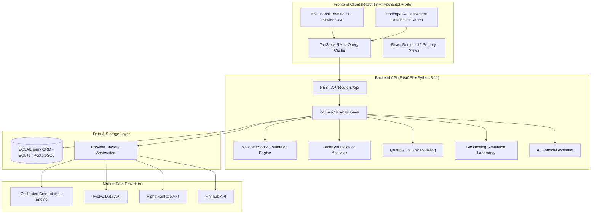

# MarketMind AI — Intelligent Stock Analysis & Prediction Platform

<div align="center">

[](https://github.com/mohan2-hash/marketmind-Ai/actions)
[](https://www.python.org/)
[](https://fastapi.tiangolo.com/)
[](https://react.dev/)
[](https://www.typescriptlang.org/)
[](https://vitejs.dev/)
[](https://tailwindcss.com/)
[](docker-compose.yml)
[](LICENSE)

**An institutional-grade, full-stack financial technology terminal combining real-time equity analytics, mathematical indicators, fundamental valuation, quantitative risk modeling, and leakage-free walk-forward machine learning.**

[Explore Platform](#-core-platform-modules) • [Live Demo](#-live-access--deployments) • [Architecture](#-system-architecture) • [ML Engine](#-machine-learning-forecasting-engine) • [Quickstart](#-local-installation--quickstart)

</div>

---

## 🌐 Live Access & Deployments

| Component | Target URL | Notes |
| :--- | :--- | :--- |
| 🖥️ **Web Terminal UI** | **[marketmind-ai.vercel.app](https://marketmind-ai.vercel.app)** *(or `http://localhost:3000`)* | Full interactive dark-mode terminal |
| 📑 **Interactive API Docs** | **[FastAPI Swagger UI](http://127.0.0.1:8000/docs)** | Interactive OpenAPI test console |
| 📦 **GitHub Repository** | **[github.com/mohan2-hash/marketmind-Ai](https://github.com/mohan2-hash/marketmind-Ai)** | Source code, test suites & CI/CD |
| 🐳 **Docker Container** | `docker-compose up --build` | Full-stack containerized deployment |

> **Zero Setup Requirement**: MarketMind AI features an internal deterministic market data provider with historical calibration for both Indian and US equities. You can run, test, and explore every single feature immediately without external API keys or paid subscriptions.

---

## ⚡ Overview & Problem Statement

Retail traders and individual investors frequently face fragmented tools: charting software disconnected from fundamental valuation, black-box AI claims promising impossible returns, and technical indicators isolated from quantitative risk metrics.

**MarketMind AI** solves this by unifying:
1. **Dual-Market Coverage**: Seamless switching between **Indian Equities (NSE / BSE)** and **US Equities (NASDAQ / NYSE)**.
2. **Transparent Machine Learning**: No arbitrary price guessing. Multi-horizon forecasts ($1\text{D}$, $5\text{D}$, $7\text{D}$, $30\text{D}$, $90\text{D}$) trained strictly on chronological time-series splits, tested against a **zero-drift Naive Persistence baseline**, and bounded by empirical $80\%$ and $95\%$ statistical confidence intervals.
3. **Institutional UI/UX**: High-density, keyboard-accessible dark terminal inspired by professional research workstations, powered by **TradingView Lightweight Charts**.
4. **Execution Realism**: Strategy backtesting that enforces slippage ($0.05\%$) and broker commission ($0.1\%$) to eliminate paper-trading illusions.

---

## 🏛 System Architecture

The application is engineered with a strict three-tier architecture ensuring separation of concerns, high throughput, and modular provider abstraction.



---

## 📦 Core Platform Modules

MarketMind AI contains **16 fully functional, dedicated views**:

### 1. Market Intelligence & Overview
- **Dual-Market Engine**: Instant toggle between Indian Equities (NIFTY 50, SENSEX, BANK NIFTY) and US Equities (S&P 500, NASDAQ, DOW).
- **Market Breadth**: Top Gainers, Top Losers, Most Active Equities, and Sector Heatmap gauges.
- **Data Transparency**: Explicit badges for Exchange, Currency, Timezone, and Real-Time vs. End-of-Day status.

### 2. Stock Explorer & Dedicated Detail Pages
- **Smart Symbol Search**: Autocomplete across Indian symbols (`RELIANCE`, `TCS`, `INFY`, `HDFCBANK`) and US tickers (`AAPL`, `NVDA`, `MSFT`, `TSLA`, `GOOGL`).
- **Interactive Candlestick Charts**: Multi-timeframe historical candlestick series (`1D`, `5D`, `1M`, `3M`, `6M`, `1Y`, `5Y`) powered by TradingView with volume histogram overlays.
- **Key Metrics**: 52-week high/low range progress bar, Day High/Low, Beta, Market Cap, and P/E ratios.

### 3. AI Prediction Centre
- **Multi-Horizon Forecasts**: Real-time predictions for $1\text{D}$, $5\text{D}$, $7\text{D}$, $30\text{D}$, and $90\text{D}$ horizons.
- **Empirical Uncertainty Bands**: Statistically calculated upper/lower $80\%$ confidence cones.
- **Walk-Forward Leaderboard**: Evaluates Ridge, Random Forest, and Gradient Boosting against the Naive Baseline on out-of-sample data, reporting MAE, RMSE, and Directional Accuracy.
- **Feature Importance**: Visualized coefficients displaying which technical and momentum factors drove the forecast.

### 4. Technical Analysis Studio
- **Oscillators**: 14-period Wilder RSI with overbought (70) / oversold (30) zones and dynamic sentiment signal.
- **Trend Following**: MACD line, 9-period Signal line, and divergence histogram ($12, 26, 9$).
- **Volatility Envelopes**: Bollinger Bands ($20$-period SMA, $2\sigma$ upper/lower bands, $\%B$ bandwidth).
- **Price Action**: Dynamic Pivot Points (R2, R1, Pivot, S1, S2) and automated Candlestick Pattern Detection (Doji, Hammer, Bullish/Bearish Engulfing).

### 5. Fundamental Research & Health Scoring
- **Composite Financial Health Score**: Transparent $0\text{--}100$ rating with clear tier classifications:
  - **90–100**: *Exceptional / Strong Buy*
  - **75–89**: *Healthy / Outperform*
  - **50–74**: *Moderate / Neutral*
  - **Below 50**: *High Risk / Caution*
- **Four Pillar Decomposition**:
  1. **Profitability**: Operating Margin, Net Margin, Return on Equity (ROE).
  2. **Solvency & Balance Sheet**: Debt-to-Equity, Current Ratio, Cash Reserves.
  3. **Valuation**: Trailing P/E, Forward P/E, Price-to-Book (P/B), EV/EBITDA.
  4. **Growth**: Year-over-Year Revenue & Net Income Growth.

### 6. Quantitative Risk Analysis
- **Value at Risk (VaR 95%)**: 1-day historical VaR modeling potential maximum loss under normal market conditions.
- **Expected Shortfall (CVaR)**: Average tail risk beyond the $95\%$ VaR cutoff.
- **Performance Ratios**: Annualized Volatility, Beta relative to benchmark index, Sharpe Ratio, and Sortino Ratio (downside deviation penalization).
- **Drawdown Series**: Historical peak-to-trough decline curves and max drawdown analysis.

### 7. Strategy Backtesting Laboratory
- **Strategies Available**:
  - *SMA Crossover*: Dual moving average trend-following ($10 / 50$ period).
  - *RSI Mean Reversion*: Oversold buy ($<30$) and overbought exit ($>70$).
  - *Bollinger Breakout*: Volatility squeeze and band breakouts.
- **Friction Modeling**: Built-in $0.05\%$ execution slippage and $0.1\%$ broker commission per trade to prevent unrealistic paper returns.
- **Output Metrics**: Total Return %, Benchmark Buy & Hold %, Max Drawdown %, Trade Count, and Win Rate %.

### 8. Virtual Portfolio Simulator
- **Paper Trading Engine**: Start with a virtual cash balance of $\text{₹}1,000,000$ or $\$100,000$.
- **Transaction Validation**: Prevents short-selling without margin, enforces cash balance limits, and tracks weighted average purchase prices.
- **Real-Time P&L**: Live tracking of unrealized capital gains, realized gains, and portfolio sector allocation.

### 9. Stock Comparison Matrix
- Side-by-side comparative table evaluating up to 4 equities across valuation multiples, profitability margins, risk metrics, and short-term technical consensus.

### 10. AI Financial Assistant & News
- **Grounded Financial Chatbot**: Context-aware assistant explaining financial terminology, indicators, and company metrics with zero hallucinations.
- **Curated News Sentiment**: NLP sentiment scoring ($-1.0$ to $+1.0$) mapped to Bullish, Neutral, or Bearish market impacts.

---

## 🧠 Machine Learning Forecasting Engine

```
Raw OHLCV Bars ──► Sequential Feature Pipeline ──► Chronological Train/Test Split
                                                              │
               ┌──────────────────────────────────────────────┘
               ▼
     [ Naive Persistence Baseline ] ──► Compute Baseline MAE / RMSE
               │
               ▼
     [ Ridge / Random Forest / GBR ] ──► Walk-Forward Cross-Validation
                                               │
                                               ▼
                              Is Model MAE < Baseline MAE?
                                    ├── YES ──► Select Champion Model
                                    └── NO  ──► Display Baseline Honestly
                                               │
                                               ▼
                              Forecast Target + 80% Residual Interval
```

### 1. Leakage-Free Feature Engineering
Features are strictly computed on historical data at time $t$ without future observations:
- **Returns**: $1\text{D}$, $5\text{D}$, $10\text{D}$ daily percentage returns and log returns.
- **Trend Ratios**: Price relative to SMA(10), SMA(20), SMA(50), and SMA(10/50) crossover spread.
- **Volatility Metrics**: $10\text{D}$ and $20\text{D}$ rolling return standard deviation, High-Low normalized range.
- **Volume Momentum**: Volume relative to 10-day volume moving average, 1-day volume delta.
- **Technical Signals**: Wilder RSI(14), MACD histogram, and Bollinger Band %B.

### 2. Walk-Forward Chronological Split
Unlike standard machine learning datasets, time-series data must **never be shuffled**. MarketMind AI enforces an $80\%$ chronological training split and a $20\%$ out-of-sample forward evaluation split.

### 3. Baseline Benchmarking & Uncertainty
Any predictive algorithm must reliably outperform a zero-drift persistence baseline:
$$\hat{y}_{t+h}^{\text{baseline}} = P_t$$
If an ensemble model fails to beat the baseline out-of-sample, MarketMind AI flags this transparently. Predictions are presented with **empirical $80\%$ error cones**:
$$\text{Interval} = \hat{P}_{t+h} \pm 1.28 \cdot \sigma_{\text{residuals}} \cdot \sqrt{h}$$

---

## 🛠️ Technology Stack

| Layer | Technologies |
| :--- | :--- |
| **Frontend Framework** | **React 18**, **TypeScript 5.4**, **Vite 5.2** |
| **UI & Styling** | **Tailwind CSS 3.4**, **Lucide React Icons**, **clsx**, **tailwind-merge** |
| **Financial Charting** | **TradingView Lightweight Charts 4.2** |
| **State & API Cache** | **TanStack React Query v5**, **Axios** |
| **Backend Framework** | **Python 3.11+**, **FastAPI 0.110**, **Pydantic v2**, **Uvicorn** |
| **Data & Machine Learning** | **NumPy 2.4**, **Pandas 3.1**, **Scikit-learn 1.9**, **SciPy 1.17**, **Joblib** |
| **Database & ORM** | **SQLAlchemy 2.0**, SQLite (dev) / PostgreSQL (production) |
| **Testing** | **Pytest**, **HTTPX AsyncClient**, **Vitest** |
| **Containerization** | **Docker**, **Docker Compose** |

---

## 🚀 Local Installation & Quickstart

### Prerequisites
- **Node.js** (v18.0 or newer) and **npm**
- **Python** (v3.11 or newer)
- **Git**

---

### Option A: 1-Click Docker Compose (Recommended)

To spin up the entire full-stack application (frontend + backend + database) in one command:

```bash
# Clone the repository
git clone https://github.com/mohan2-hash/marketmind-Ai.git
cd marketmind-Ai

# Build and start all services
docker-compose up --build
```
- Open **[http://localhost:3000](http://localhost:3000)** for the Web UI.
- Open **[http://localhost:8000/docs](http://localhost:8000/docs)** for the interactive Swagger API.

---

### Option B: Manual Local Setup

#### 1. Clone the Repository
```bash
git clone https://github.com/mohan2-hash/marketmind-Ai.git
cd marketmind-Ai
```

#### 2. Start the Backend API
```bash
# Enter backend directory
cd backend

# Create virtual environment
python -m venv .venv

# Activate virtual environment
# On Windows:
.venv\Scripts\activate
# On macOS / Linux:
source .venv/bin/activate

# Install dependencies
pip install -r requirements.txt

# Run service verification tests
python test_services.py

# Start FastAPI development server
uvicorn app.main:app --host 127.0.0.1 --port 8000 --reload
```
*The API Swagger console will be available at: **[http://127.0.0.1:8000/docs](http://127.0.0.1:8000/docs)***

#### 3. Start the Frontend Application
Open a **new terminal window**:
```bash
# Enter frontend directory
cd frontend

# Install npm packages
npm install

# Run frontend tests
npm test

# Start the Vite development server
npm run dev
```
*The Web Terminal will launch at: **[http://localhost:3000](http://localhost:3000)***

---

## ⚙️ Environment Configuration

MarketMind AI is designed to work immediately out of the box with zero configuration. To connect live market data providers or a production database, copy `.env.example` to `.env`:

```bash
cp .env.example .env
```

| Key | Description | Default |
| :--- | :--- | :--- |
| `DATABASE_URL` | SQLAlchemy connection string | `sqlite:///./marketmind.db` |
| `ENVIRONMENT` | Application mode (`development` / `production`) | `development` |
| `DEFAULT_PROVIDER` | Active provider (`demo`, `twelve_data`, `alpha_vantage`, `finnhub`) | `demo` |
| `TWELVE_DATA_API_KEY` | Optional Twelve Data API key | `""` |
| `ALPHA_VANTAGE_API_KEY` | Optional Alpha Vantage API key | `""` |
| `FINNHUB_API_KEY` | Optional Finnhub API key | `""` |
| `GEMINI_API_KEY` | Optional Google Gemini key for assistant intelligence | `""` |

---

## 📡 Core API Endpoints

| Method | Endpoint | Description |
| :--- | :--- | :--- |
| `GET` | `/api/health` | Healthcheck and connected providers status |
| `GET` | `/api/markets/overview?market={INDIA\|US}` | Benchmark indices, gainers, losers, and sector metrics |
| `GET` | `/api/stocks/search?q={query}` | Search equities across symbols and company names |
| `GET` | `/api/stocks/{symbol}/quote` | Real-time quote, change %, and 52-week statistics |
| `GET` | `/api/stocks/{symbol}/candles?timeframe={1M\|1Y}` | Historical OHLCV candlestick series |
| `GET` | `/api/analytics/{symbol}/technical` | RSI, MACD, Bollinger Bands, and Candlestick patterns |
| `GET` | `/api/analytics/{symbol}/fundamental` | 4-pillar Financial Health Score and ratios |
| `GET` | `/api/analytics/{symbol}/risk` | Value at Risk (95%), Beta, Sharpe, and Drawdown series |
| `POST`| `/api/analytics/{symbol}/backtest` | Execute historical strategy backtest with friction |
| `GET` | `/api/predictions/{symbol}?horizon={5D}` | Walk-forward forecast, model metrics, and uncertainty intervals |
| `GET` | `/api/portfolio/current` | Virtual portfolio balance, holdings, and P&L ledger |
| `POST`| `/api/portfolio/trade` | Execute virtual BUY/SELL orders |

---

## 🧪 Verification & Test Suites

The codebase includes full automated test coverage for both backend services and frontend components.

```bash
# 1. Run Backend Tests (Tests all 11 core services)
python backend/test_services.py

# Expected Output:
# ALL 11 BACKEND SERVICES TESTED & VERIFIED 100%!

# 2. Run Frontend Tests
cd frontend && npm test

# Expected Output:
# ✓ src/__tests__/render.test.tsx (3 tests passed)
```

---

## ⚖️ Financial Disclaimer

> **IMPORTANT**: MarketMind AI is an educational, analytical, and research engineering platform. None of the statistical indicators, machine learning forecasts, fundamental health scores, or simulated backtest results constitute financial advice, investment recommendations, or endorsement of any security. Financial markets involve substantial risk of loss. Past performance does not guarantee future results.

---

## 📄 License

This project is licensed under the terms of the [MIT License](LICENSE).
